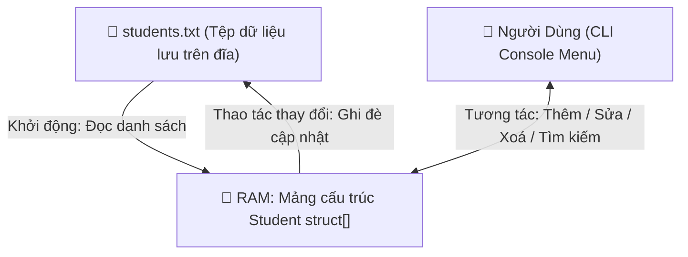

<div align="center">

# 🎓 STUDENT MANAGEMENT SYSTEM IN PURE C 🎓
### 📋 Lightweight File-Based CLI Student Records Application
*Ứng Dụng Quản Lý Hồ Sơ Sinh Viên Bằng Ngôn Ngữ C Thuần Với Cơ Chế Lưu Trữ Tệp Tin*

[](https://en.wikipedia.org/wiki/C_(programming_language))
[](https://github.com/baolam/crud-students-with-c)
[](https://github.com/baolam/crud-students-with-c)
[](https://github.com/baolam/crud-students-with-c)

---

</div>

> [!IMPORTANT]
> **CRUD Students with C** là chương trình bảng điều khiển dòng lệnh hoàn chỉnh thể hiện kỹ thuật quản lý bộ nhớ động, xử lý chuỗi ký tự cấp thấp và thao tác đọc/ghi tệp tin (File I/O) tối ưu trong ngôn ngữ lập trình C nguyên bản.

---

## 📑 Mục Lục (Table of Contents)
- [✨ Tính Năng Nổi Bật (CRUD)](#-tính-năng-nổi-bật-crud)
- [🏗️ Sơ Đồ Luồng Dữ Liệu](#️-sơ-đồ-luồng-dữ-liệu)
- [📂 Cấu Trúc Dự Án](#-cấu-trúc-dự-án)
- [🚀 Hướng Dẫn Biên Dịch & Chạy](#-hướng-dẫn-biên-dịch--chạy)
- [📜 Giấy Phép (License)](#-giấy-phép-license)

---

## ✨ Tính Năng Nổi Bật (CRUD)

| Thao Tác | Chức Năng | Chi Tiết Thực Hiện |
| :---: | :--- | :--- |
| ➕ **Create** | Thêm mới sinh viên | Nhập mã SV, họ tên, ngày tháng năm sinh, điểm trung bình với cơ chế kiểm tra tính hợp lệ dữ liệu. |
| 📖 **Read** | Xem danh sách & Tìm kiếm | Hiển thị bảng danh sách sinh viên định dạng bảng ngay ngắn; tìm kiếm nhanh theo mã hoặc tên. |
| ✏️ **Update** | Cập nhật hồ sơ | Chỉnh sửa điểm số và thông tin cá nhân của sinh viên mà không làm xáo trộn thứ tự danh sách. |
| ❌ **Delete** | Xoá bản ghi | Xoá sinh viên khỏi danh sách và giải phóng bộ nhớ tương ứng. |
| 💾 **Persistence**| Tự động lưu trữ tệp | Đồng bộ toàn bộ dữ liệu vào `students.txt`, tự động khôi phục dữ liệu ở lần khởi động sau. |

---

## 🏗️ Sơ Đồ Luồng Dữ Liệu



---

## 📂 Cấu Trúc Dự Án

```bash
crud-students-with-c/
├── 📄 main.c               # Mã nguồn chính chứa toàn bộ hàm xử lý nghiệp vụ và giao diện console
├── 📄 students.txt         # Cơ sở dữ liệu dạng văn bản lưu trữ thông tin sinh viên
├── 📄 CRUD_STUDENT.dev     # File dự án mở nhanh bằng phần mềm Dev-C++
├── 📄 CRUD_STUDENT.layout  # Cấu hình giao diện Dev-C++
└── 📄 README.md            # Tài liệu dự án
```

---

## 🚀 Hướng Dẫn Biên Dịch & Chạy

### Sử dụng GCC (Command Line)
```bash
# Clone repository
git clone https://github.com/baolam/crud-students-with-c.git
cd crud-students-with-c

# Biên dịch bằng GCC
gcc -std=c99 main.c -o student_manager

# Chạy chương trình
./student_manager
```

### Sử dụng IDE Dev-C++
1. Mở file `CRUD_STUDENT.dev`.
2. Bấm phím `F11` (Compile & Run) để khởi chạy ứng dụng trực tiếp.

---

<div align="center">

## 📜 Giấy Phép (License)

Dự án được phân phối dưới giấy phép **MIT License**.

---
**Made with ❤️ by [Bảo Lâm](https://github.com/baolam)**

</div>
